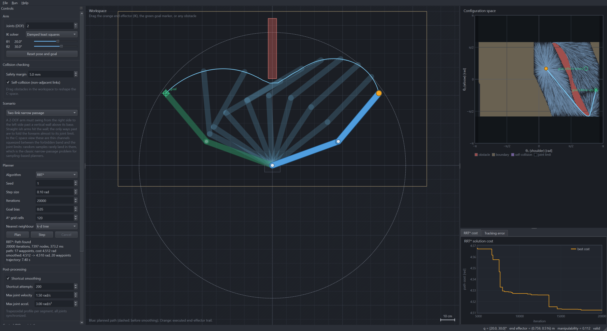
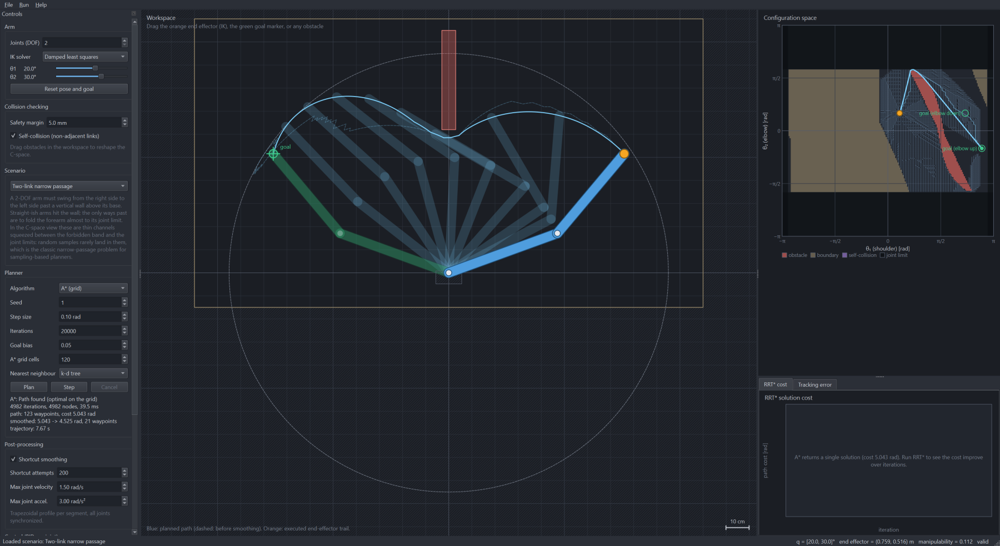
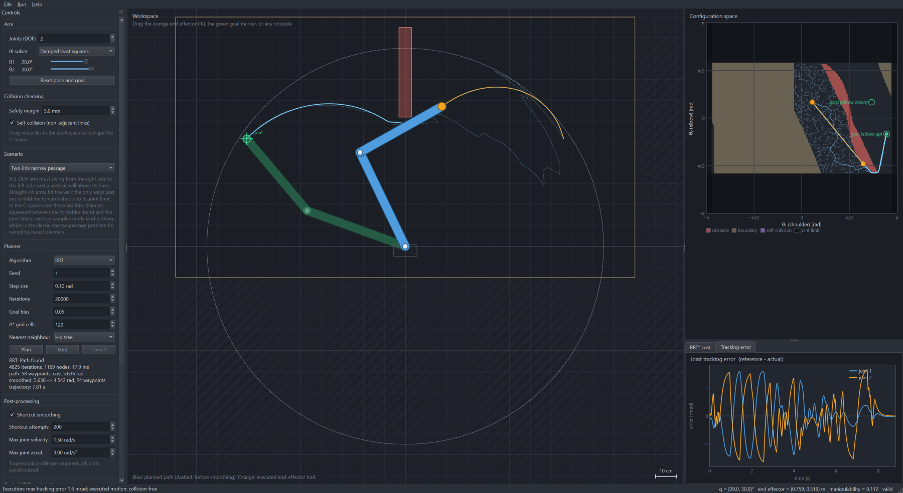
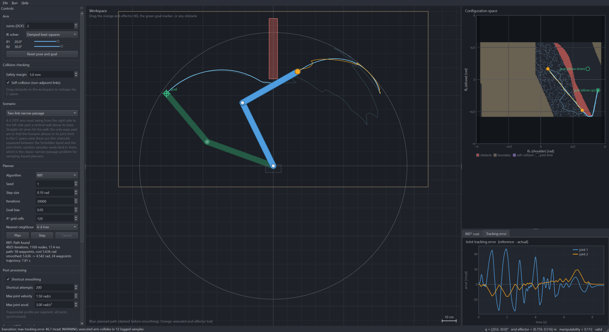
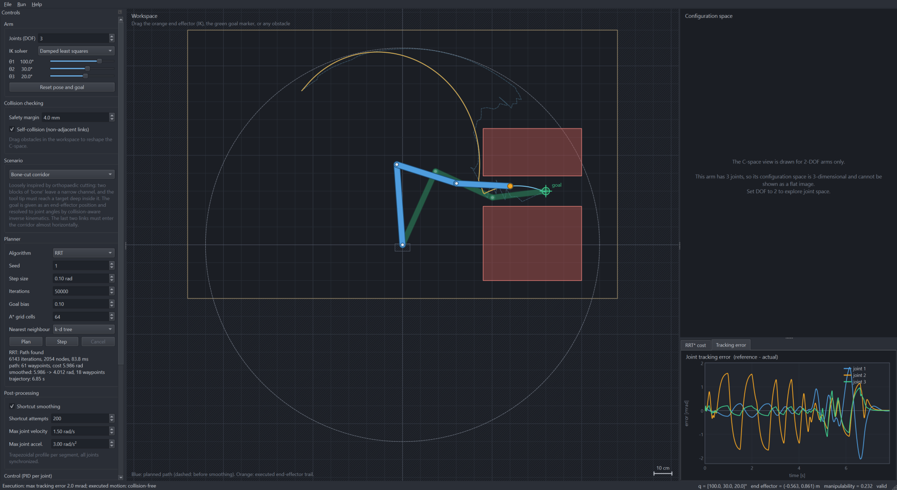
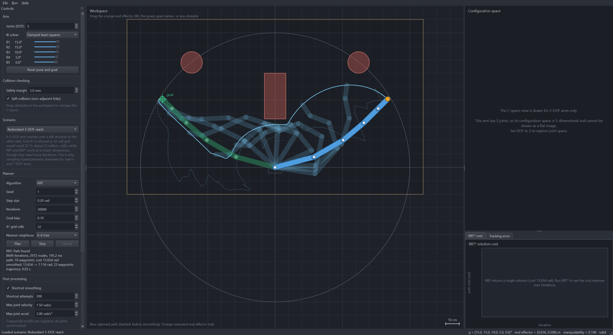

# arm-motion-planner

A planar robot arm **motion planning and control** demo in modern C++ (C++20), written without
ROS, OMPL or MoveIt. The motion planning and control algorithms are implemented from scratch:

* forward and inverse kinematics (analytic 2-link, damped least squares N-link);
* collision checking with a provable continuous-safety edge check;
* RRT, RRT\* and grid A\* over configuration space, with brute-force and k-d tree nearest
  neighbours;
* shortcut smoothing and synchronized trapezoidal time parameterization;
* PID joint control (anti-windup, derivative on measurement with filtering, feedforward)
  on simulated joint dynamics;
* a Qt 6 GUI that shows the workspace, the configuration space, the search tree, and the
  executed motion.

Requirements carry IDs, every requirement is traced to automated tests (checked in CI), and
planning is deterministic for a given seed.

> **Disclaimer.** This is a demonstration project. It borrows practices from
> regulated medical device software (numbered requirements, traceability, determinism), but it
> is **not** clinical software and has not been validated for any medical use.

## Build

Requirements: CMake 3.21+, a C++20 compiler, Python 3 (for the traceability check), and
internet access on the first configure (Eigen, GoogleTest and nlohmann/json are fetched
automatically). Qt 6 is only needed for the GUI.

### Windows (PowerShell), MSVC: core library and tests

```powershell
cmake --preset windows-msvc
cmake --build --preset windows-msvc
ctest --preset windows-msvc
```

### Windows (PowerShell), MinGW with Qt: everything including the GUI

```powershell
$env:QT_ROOT = "C:/Qt/6.9.2/mingw_64"
$env:PATH = "C:/Qt/Tools/mingw1310_64/bin;C:/Qt/Tools/Ninja;$env:PATH"
cmake --preset windows-mingw
cmake --build --preset windows-mingw
ctest --preset windows-mingw
```

(A git-ignored `CMakeUserPresets.json` can hold these paths instead; see `local-qt-mingw`.)

### Linux

```bash
sudo apt install ninja-build qt6-base-dev   # Qt optional
cmake --preset linux
cmake --build --preset linux
ctest --preset linux
```

## Run the GUI

After a MinGW/Qt build (`windeployqt` copies the Qt DLLs and the scenarios next to the executable):

```powershell
.\build\local-qt-mingw\bin\arm-motion-planner.exe                     # built-in 3-DOF demo scene
.\build\local-qt-mingw\bin\arm-motion-planner.exe --dof 2             # 2-DOF arm: C-space view enabled
.\build\local-qt-mingw\bin\arm-motion-planner.exe --scenario scenarios\02_two_link_narrow_passage.json --plan rrtstar
.\build\local-qt-mingw\bin\arm-motion-planner.exe --scenario scenarios\01_open_space.json --plan rrt --execute
```

* **Workspace view:** drag the orange end effector (the arm follows by inverse kinematics),
  the green goal marker, or any obstacle. The ghosted green arm is the goal pose. Links in
  collision turn red. After planning, the blue curve is the end-effector path and the faint
  arms are poses along it.
* **C-space view (2-DOF):** each point is one arm pose; click or drag to set it. Coloured
  regions are C-obstacles sampled live from the collision checker. After planning, the thin
  lines are the search tree (A\*: the expanded cells) and the bright line is the path. The two
  hollow circles are the elbow-up and elbow-down IK solutions of the same workspace goal.
* **Controls:** scenario, planner (RRT, RRT\*, A\*), seed, step size, iterations, goal bias,
  A\* grid size, nearest-neighbour index. **Plan** runs on a worker thread, so the UI stays
  responsive, and **Cancel** stops it. **Step** re-plans with 100 more iterations each click:
  planning is deterministic, so you watch the *same* tree grow.
* **Post-processing:** shortcut smoothing (on by default) and joint velocity and acceleration
  limits for the trapezoidal time parameterization. The dashed blue curve is the path before
  smoothing.
* **Control:** Kp, Ki, Kd, derivative filter cutoff, torque limit, anti-windup, acceleration
  feedforward and gravity. **Execute trajectory** simulates the PID-controlled arm at 1 kHz and
  plays it back in real time: the solid arm is the controlled one, the dashed skeleton is the
  reference, and the orange trail is where the tip actually went. Editing any gain
  re-simulates instantly ("live tuning"). The summary reports per-joint maximum and final
  error, saturation, and whether the *executed* arm stayed collision-free.
* **Plots:** the RRT\* cost against iterations (live while planning), and the per-joint tracking
  error against time. Toggle feedforward to see the error spikes at every acceleration ramp
  shrink, or turn gravity on and set Ki = 0 to see the steady-state droop the integral term
  removes.
* **Status bar:** joint angles, end-effector position, manipulability, and why the current
  pose is invalid, if it is.

**Menus and shortcuts.** File: Open scenario (Ctrl+O), Save screenshot (Ctrl+Shift+S),
Export tracking log as CSV (Ctrl+E). Run: Plan (F5), Step (F6), Cancel (Esc), Execute (F7).
Playback speed is selectable from 0.25x to 4x next to the Execute button.

**Command-line options** (useful for demos and scripted screenshots): `--dof N`,
`--scenario FILE`, `--plan rrt|rrtstar|astar`, `--execute`, `--pause-at SECONDS`,
`--no-feedforward`, `--screenshot FILE.png`, `--delay MS`.

## Screenshots

RRT\* in the 2-DOF narrow passage. The C-space view (right) shows the search tree filling the
free space and the path squeezing through the thin channel at the joint limit:



The same problem with grid A\*: explored cells and a staircase-shaped grid-optimal path.



Executing the smoothed path with PID plus acceleration feedforward (tracking error about
2 mrad):



The same execution with feedback only. Tracking errors reach about 47 mrad, and the status
bar reports that the *executed* arm clips the wall even though the planned path was
collision-free. This is why feedforward is on by default.



Bone-cut corridor (3-DOF, goal given as an end-effector position) and the 5-DOF reach, where
A\* is refused:




**Regenerating the images.** After building the GUI, run `.\tools\capture_screenshots.ps1`
from the repository root. It drives the app with the command-line options above. Planning is
deterministic, so the images come out the same every time.

**Recording a GIF** (not generated automatically). Two simple options:

* [ScreenToGif](https://www.screentogif.com/) (Windows): record the window while pressing
  F5 (Plan) and then F7 (Execute).
* ffmpeg: start the app, then
  `ffmpeg -f gdigrab -framerate 20 -i title="arm-motion-planner" -t 12 demo.gif`
  while it plans and executes, for example with
  `arm-motion-planner.exe --scenario scenarios\02_two_link_narrow_passage.json --plan rrtstar --execute`.
  Add `-vf "fps=15,scale=1200:-1"` to keep the file small.

## Scenarios

JSON files in [scenarios/](scenarios/). The format is documented in
[core/include/amp/scenario.hpp](core/include/amp/scenario.hpp).

| File | What it shows |
|---|---|
| `01_open_space.json` | 3-DOF, nearly free space: compare path quality across planners. |
| `02_two_link_narrow_passage.json` | 2-DOF narrow passage: the forearm must fold under a wall. Best viewed in the C-space view. |
| `03_cluttered_field.json` | 3-DOF among eight mixed obstacles. |
| `04_astar_coarse_grid_fails.json` | A\* at 14 cells per joint finds no path although one exists (resolution completeness). |
| `05_bone_cut_corridor.json` | Loosely orthopaedic: the tool tip must reach deep into a narrow channel; goal given as an end-effector position. |
| `06_redundant_reach_5dof.json` | 5-DOF: A\* refuses (curse of dimensionality); sampling planners still work. |

`amp_bench --check` diagnoses every scenario (start and goal validity, one run per planner)
and prints an ASCII picture of the C-space for 2-DOF scenarios.

## Benchmark

```powershell
.\build\local-qt-mingw\bin\amp_bench.exe --seeds 50 --out benchmark.md
```

Results below: Intel Core i7-9700F, Windows 10, MinGW GCC 13.1 Release build, single-threaded, each scenario's own iteration budget. Treat absolute times as indicative only.

#### Planner comparison (50 seeds per sampling planner; A* is deterministic)

| Scenario | DOF | Planner | Success | Median time (ms) | Median cost (rad) | Median nodes |
|---|---:|---|---:|---:|---:|---:|
| Open space | 3 | RRT | 50/50 | 0.7 | 3.752 | 113 |
| Open space | 3 | RRT* | 50/50 | 672.8 | 2.815 | 8311 |
| Open space | 3 | A* | 1/1 | 15.3 | 3.382 | 313 |
| Two-link narrow passage | 2 | RRT | 50/50 | 13.8 | 5.637 | 1183 |
| Two-link narrow passage | 2 | RRT* | 50/50 | 388.6 | 4.510 | 7514 |
| Two-link narrow passage | 2 | A* | 1/1 | 38.8 | 5.043 | 4982 |
| Cluttered field | 3 | RRT | 30/50 | 202.2 | 7.668 | 3783 |
| Cluttered field | 3 | RRT* | 32/50 | 3682.1 | 4.668 | 5870 |
| Cluttered field | 3 | A* | 1/1 | 253.9 | 5.162 | 1176 |
| A* fails: grid too coarse | 3 | RRT | 45/50 | 233.9 | 6.958 | 5648 |
| A* fails: grid too coarse | 3 | RRT* | 47/50 | 1642.6 | 4.983 | 12106 |
| A* fails: grid too coarse | 3 | A* | 0/1 | 54.8 | - | 648 |
| Bone-cut corridor | 3 | RRT | 48/50 | 396.6 | 6.495 | 8186 |
| Bone-cut corridor | 3 | RRT* | 48/50 | 6045.6 | 4.012 | 14764 |
| Bone-cut corridor | 3 | A* | 1/1 | 1442.1 | 4.274 | 16676 |
| Redundant 5-DOF reach | 5 | RRT | 49/50 | 437.3 | 14.376 | 5420 |
| Redundant 5-DOF reach | 5 | RRT* | 48/50 | 1981.6 | 9.715 | 9670 |
| Redundant 5-DOF reach | 5 | A* | refused (5 DOF) | - | - | - |

Cost is the C-space path length in radians, before smoothing. Times are wall-clock on the machine that ran the benchmark, for a Release build.

#### Nearest-neighbour search (2000 queries, uniformly random points)

| DOF | Points | Brute force (µs/query) | k-d tree (µs/query) | Speed-up |
|---:|---:|---:|---:|---:|
| 2 | 1000 | 5.20 | 0.48 | 10.9x |
| 2 | 10000 | 67.25 | 1.08 | 62.2x |
| 2 | 50000 | 349.96 | 1.42 | 247.0x |
| 3 | 1000 | 6.14 | 0.94 | 6.5x |
| 3 | 10000 | 67.09 | 1.47 | 45.8x |
| 3 | 50000 | 381.31 | 2.27 | 167.9x |
| 6 | 1000 | 9.15 | 5.45 | 1.7x |
| 6 | 10000 | 101.23 | 12.61 | 8.0x |
| 6 | 50000 | 640.84 | 22.61 | 28.3x |

How to read it:

* **RRT is fast but its paths are long.** RRT\* spends 10 to 100 times longer and returns paths
  25 to 40% shorter, as asymptotic optimality predicts. A\* is optimal *on its grid*, which is
  why RRT\* can beat it (open space: 2.82 vs 3.38 rad).
* **A\* is reliable in 2 to 3 DOF when the grid is fine enough** (deterministic, no failed
  seeds), fails when the grid is too coarse (`04`), and is refused at 5 DOF.
* **Success rates below 100%** (cluttered field: 30/50 for RRT) mean "not within this
  iteration budget", not "no path": sampling planners are only probabilistically complete.
  Raising `max_iterations` raises the rate.
* **The k-d tree's advantage shrinks with dimension** (247x at 2 DOF, 28x at 6 DOF, for 50k
  points). That is the curse of dimensionality again.

## Project structure

```
core/        amp_core static library (no Qt): kinematics, C-space, collision, planners,
             smoothing, trajectories, dynamics, PID, scenarios
app/         Qt 6 Widgets GUI (thin client of amp_core)
tests/       GoogleTest suites, each test tagged with the requirement it verifies
bench/       amp_bench: planner and nearest-neighbour benchmark, scenario diagnostics
scenarios/   JSON planning problems
tools/       check_traceability.py, capture_screenshots.ps1
docs/        requirements, traceability, architecture, algorithms, walkthrough
```

## Documentation

* [docs/WALKTHROUGH.md](docs/WALKTHROUGH.md): a guided tour of the code in reading order (an afternoon)
* [docs/ALGORITHMS.md](docs/ALGORITHMS.md): the math behind every algorithm, with proofs where safety depends on them
* [docs/ARCHITECTURE.md](docs/ARCHITECTURE.md): module diagram, data flow, threading model, design decisions
* [docs/REQUIREMENTS.md](docs/REQUIREMENTS.md): 42 numbered "shall" requirements
* [docs/TRACEABILITY.md](docs/TRACEABILITY.md): requirement-to-test matrix (generated; CI fails on any gap)

API documentation: every public function has a Doxygen comment, and `doxygen` from the
repository root writes HTML to `build/doxygen` (the Doxyfile is minimal; it was not run as
part of this project's checks).

## Limitations

This is a teaching project, not a product. Known limitations:

* Planar arm, 2D geometry. The real problem is 3D, with meshes and SE(3).
* Decoupled joint dynamics. No mass-matrix coupling, Coriolis terms or Coulomb friction.
* Rest-to-rest trajectory segments (safe but slow). No jerk limits.
* No sensor noise or delay in the closed-loop simulation (the derivative filter is tested
  with synthetic noise).
* Not real-time code. Planning budgets are iteration-based, not deadline-based.
* The requirements and traceability demonstrate the practice. There is no risk management
  file, SOUP analysis or coverage measurement.
* A\* refuses more than 3 DOF by design.
* Bit-identical determinism is per build. Different compilers can differ in the last bit of
  `sin` and `cos`, which a long random search can amplify.

## License

MIT. See [LICENSE](LICENSE).
