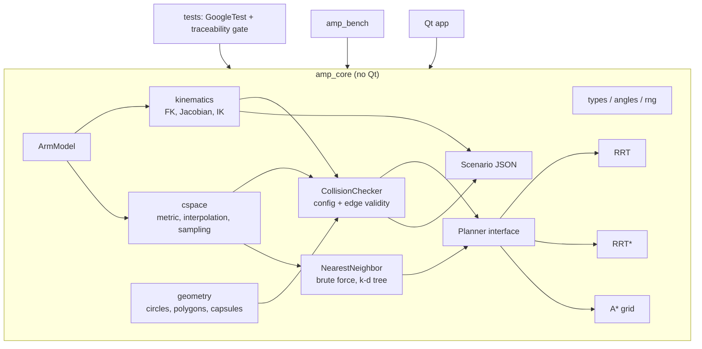
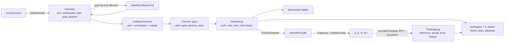
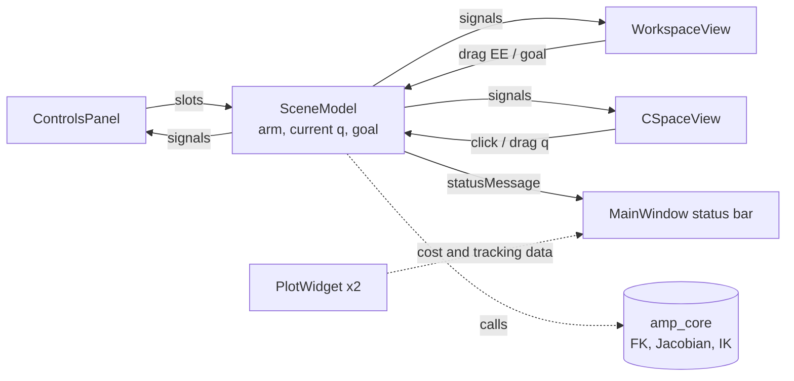

# Architecture

> Covers the whole project. This file also records the design decisions: each one lists the
> alternatives considered and why this option was chosen.

## Layout

| Directory | Contents | Depends on |
|---|---|---|
| `core/` | `amp_core` static library: kinematics, C-space, collision, planners, control | Eigen, nlohmann/json |
| `tests/` | GoogleTest unit tests plus the traceability gate | `amp_core`, GoogleTest, Python 3 |
| `bench/` | Planner and nearest-neighbour benchmark | `amp_core` |
| `app/` | Qt 6 Widgets GUI | `amp_core`, Qt 6 |
| `scenarios/` | JSON scenario files | none |
| `tools/` | `check_traceability.py` | Python 3 |

The core library has **no Qt dependency**. That keeps every algorithm testable headless
and in CI, and means the GUI is a thin client of a library that can be reviewed on its own.

## Core modules

## Data flow: scenario to plan

## Threading model

* **Core library:** no threads and no global mutable state. `CollisionChecker` and the
  planners are immutable after construction (`plan()` is `const`), so independent planning
  jobs can run in parallel safely.
* **GUI:** the UI thread owns `SceneModel` and all widgets. `PlanningController::start`
  copies the collision checker, start, goal and parameters into a lambda and runs it on a
  `QThread`. The worker shares **no** mutable state with the UI, so no locks are needed.
* **Progress and results** come back through queued `QMetaObject::invokeMethod` calls, which
  Qt executes on the UI thread.
* **Cancellation** is a `std::atomic<bool>` that the planner polls once per iteration.
* **Live tree:** the planner hands its tree to an `onTree` callback every 100 iterations. The
  controller forwards a *copy* at most every 100 ms, so the C-space view shows the tree
  growing without slowing planning down or sharing memory across threads.
* **Stale results:** the main window counts scene edits. A result that finishes after the
  user moved the arm, the goal or an obstacle is discarded rather than shown against a scene
  it was not planned for.
* **Shutdown:** the controller's destructor cancels and joins the thread, so the app can
  close mid-plan.

## GUI structure

`SceneModel` is the single source of truth. Views hold no state except purely visual
traces. They call `SceneModel` slots and repaint on its signals. The same model also holds the
obstacles, the plan result and the executed trajectory; planning runs on a worker thread
(see the threading model below).

## Design decisions (defaults chosen; open to change)

| # | Decision | Alternatives considered | Rationale |
|---|---|---|---|
| D1 | `Config` is `Eigen::VectorXd` (dynamic size) | `Eigen::Matrix<double, N, 1>` templated on DOF | DOF is a runtime property of the scenario file (2..6). Templates would force all planners to be templates or use type erasure. The cost of a heap-allocated 2..6 element vector is negligible next to collision checking. |
| D2 | Joint angles are **relative** (each link measured from the previous link) | Absolute link angles | Relative angles are what a real joint encoder measures, and they make joint limits meaningful. |
| D3 | Own `Rng` wrapper that turns raw `mt19937_64` output into doubles | `std::uniform_real_distribution` | The standard fixes the engine's output bit-exactly but not the distribution algorithm. MSVC and libstdc++ differ, which would break cross-platform determinism (REQ-GEN-001). |
| D4 | DLS IK with adaptive (manipulability-based) damping and optional seeded restarts | Fixed damping; Jacobian transpose; CCD; analytic only | Fixed damping either converges slowly everywhere (large lambda) or blows up near singularities (small lambda). Adaptive damping gives pseudo-inverse speed away from singularities and stability near them. Restarts fix the local-minimum and joint-limit stalls that every local method has. |
| D5 | Eigen fetched as headers only (FetchContent with a dummy `SOURCE_SUBDIR`) and included as `SYSTEM` | `find_package(Eigen3)` | No system install needed. `SYSTEM` keeps `/W4 /WX` and `-Werror` on our code only. Static alignment is disabled (`EIGEN_MAX_STATIC_ALIGN_BYTES=0`) to sidestep the well-known alignment pitfalls of fixed-size Eigen types stored in STL containers. |
| D6 | nlohmann/json for scenario files | Hand-written parser; Qt's QJsonDocument | The core must not depend on Qt. A hand-written JSON parser adds risk without teaching anything about motion planning. |
| D7 | Two Windows build paths: MSVC (core, tests, bench) and MinGW (adds the GUI) | MSVC only | The local Qt install is the MinGW kit, and Qt binaries are compiler-specific. The MSVC preset also builds the GUI when pointed at an MSVC Qt kit. |
| D8 | Traceability via `// @verifies REQ-...` tags above each test, checked by a Python script registered as a CTest test | Spreadsheet; test-name conventions | Tags live next to the code they describe, so they are reviewed in the same diff. The generated matrix can never silently drift because CI fails when it is stale. |
| D9 | Warnings as errors: `/W4 /WX /permissive-` (MSVC); `-Wall -Wextra -Wpedantic -Werror -Wconversion -Wshadow ...` (GCC) | Default warnings | Problems surface at compile time instead of in testing. `-Wconversion` in particular catches the silent `size_t`/`int`/`double` narrowing that is a common source of defects. |
| D10 | Custom QPainter `PlotWidget` | QtCharts | QtCharts is a separate module that is often missing (it is not in the default Qt install here, nor in Ubuntu's `qt6-base-dev`). Two line plots do not justify the dependency. |
| D11 | Unimplemented features shown as disabled, labelled control groups | Hide them until implemented | The final layout can be reviewed early, and nothing pretends to work before it does. |
| D12 | Dark Fusion theme with a shared palette (`view_style.hpp`) | Native style | Native Windows widgets do not match the dark custom-painted views. One palette keeps all views consistent. |
| D13 | Safety-margin model for edge checking: inflate links by m, sample edges so no point moves more than 2m per step | Fixed joint-space step; exact continuous collision detection | It gives a provable guarantee for obstacles of any thickness, with a step derived from physical clearance. Exact swept-volume checking in 2D is possible but complex, and does not carry over cleanly to 3D. See ALGORITHMS.md#edge-validity. |
| D14 | Touching counts as collision everywhere | Strict overlap only | Ambiguous contact errs toward safety, and the convention is stated once and tested (tangent cases). |
| D15 | `CollisionKind` report instead of `bool` | Plain boolean | Tests can assert *why* a configuration is invalid, and the GUI highlights the offending link and obstacle. |
| D16 | The GUI samples the 2-DOF C-space (200 x 200) on the UI thread | Worker thread now | It takes a few milliseconds, so dragging stays smooth. Planning (seconds) runs on a worker thread. |
| D17 | Insert-only k-d tree, no rebalancing | Balanced (median-split) rebuilds; ball tree; FLANN/nanoflann | RRT inserts points in random order, which keeps the expected depth logarithmic. Insert-only keeps the code short enough to review. The planning algorithms are deliberately written without third-party libraries. |
| D18 | Strict tie-breaking (nearest neighbour by index, A\* by g then cell) | Accept arbitrary ties | Determinism (REQ-PLN-003). It also lets tests require brute force and the k-d tree to be bit-identical. |
| D19 | A\* refuses more than 3 DOF instead of trying | Warn and run anyway | 48^4 = 5.3 million cells already needs hundreds of MB, and 48^6 = 1.2e10 is impossible. An explicit refusal with the reason is clearer than an out-of-memory crash. |
| D20 | Path cost = C-space path length (rad) | Workspace (end-effector) path length; time | It is the metric RRT\* optimises and A\* searches. Workspace length ignores the elbow, and time depends on the time parameterization, which runs after planning. |
| D21 | Scenario angles in degrees, converted to radians on load | Radians in files | Files are written and reviewed by people. Degrees are less error-prone to read. |
| D22 | Scenario goal given as an end-effector position is resolved by collision-aware IK at load time | Planners accept workspace goals | Planners stay simple (configuration to configuration), and the resolved goal is deterministic and testable. |
| D23 | GUI "Step" re-plans from scratch with 100 more iterations | Keep the planner object alive and advance it | Determinism makes a longer run an exact extension of a shorter one, so the visual effect is identical and no planner needs pausable state. |
| D24 | `amp_bench --check` prints an ASCII C-space for 2-DOF scenarios | Only the GUI | Scenarios can be designed and debugged headless. It showed, for example, that a "slot in a wall" for a 2-link arm is impossible to pass through. |
| D25 | Synchronized straight-line trapezoidal segments, rest-to-rest at waypoints | Independent per-joint profiles; parabolic blends; TOPP-RA | It keeps the executed motion on the exact segments the collision checker validated. Blending is faster but needs its own collision check. |
| D26 | Decoupled joint dynamics (constant inertia per joint) with optional gravity | Full rigid-body dynamics M(q), C(q, q') | Control behaviour stays explainable joint by joint. Gravity adds the configuration-dependent load that motivates the integral term. |
| D27 | Semi-implicit Euler at 1 kHz with zero-order-hold torque | Explicit Euler; RK4 | Symplectic at the cost of explicit Euler. The torque is piecewise constant anyway (digital controller), so RK4's accuracy would be wasted. |
| D28 | D term = Kd (r' - y'_filtered) | Derivative on error; derivative on measurement only | No derivative kick (r is never differentiated), and no velocity lag when tracking (r' is known analytically). |
| D29 | Anti-windup by conditional integration | Back-calculation; integrator clamp only | Simplest scheme that is correct for a symmetric torque limit. Back-calculation needs an extra tuning gain. |
| D30 | Simulation precomputed, then played back in real time | Simulate frame by frame in the UI loop | A run of a few seconds at 1 kHz takes milliseconds, so editing a gain re-simulates instantly ("live tuning") and playback stays smooth. |
| D31 | GUI checks the *executed* arm against the uninflated geometry | Trust the planner's guarantee | The guarantee covers the reference. Tracking error can violate it, and making that visible is the safety lesson. |
| D32 | GUI default: acceleration feedforward on | Off (pure feedback) | With feedback only, the default gains leave 50 to 80 mrad of tracking error, and the executed arm clips obstacles in 3 of 6 scenarios. With feedforward the error is about 2 mrad, inside the 5 mm margin (REQ-CTL-008). |
| D33 | Command-line options (`--scenario`, `--plan`, `--execute`, `--pause-at`, `--screenshot`) | Manual screenshots | README images can be regenerated deterministically by `tools/capture_screenshots.ps1`, and demos start in one command. |
